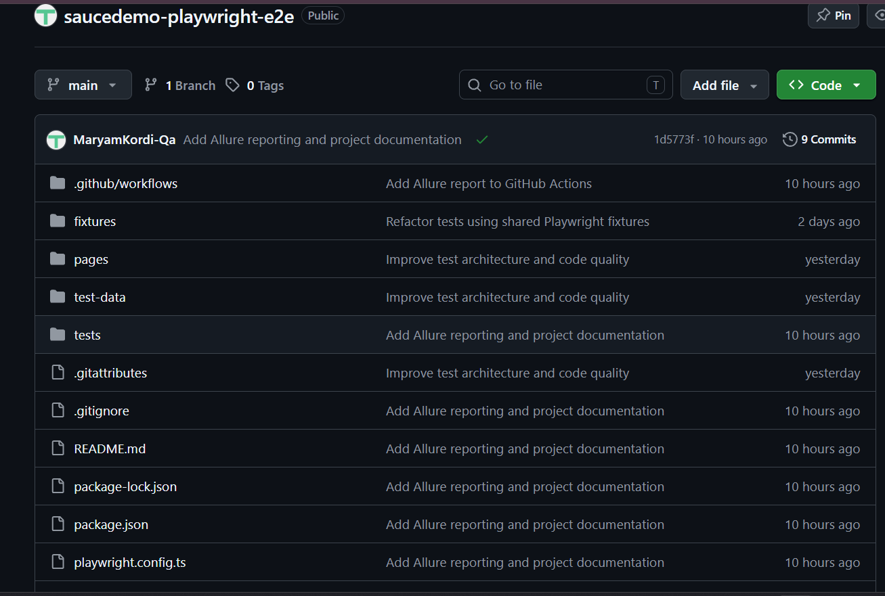
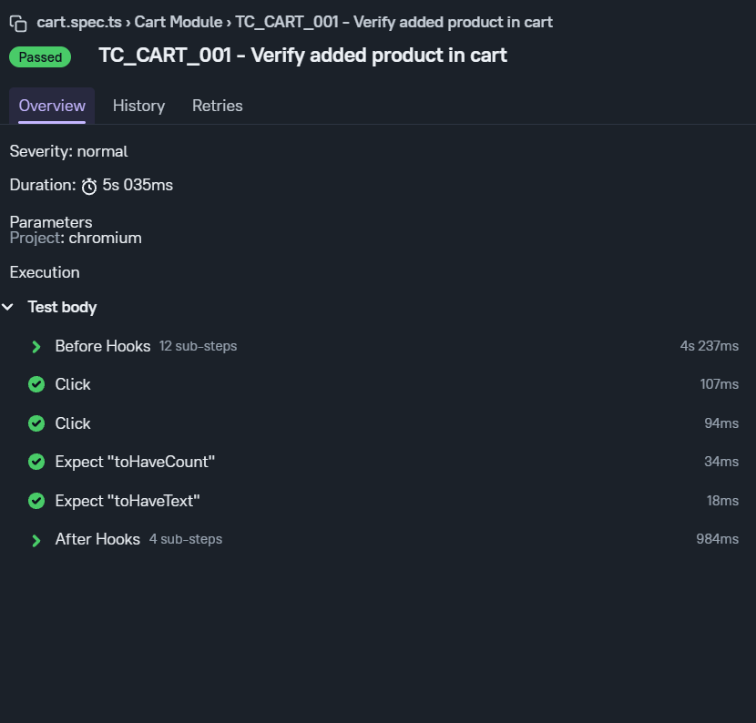
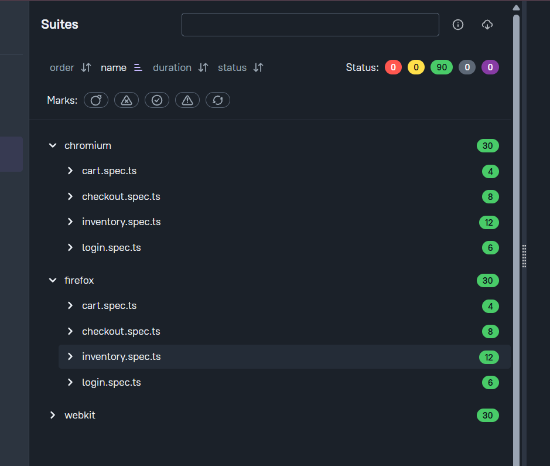

# SauceDemo - Playwright E2E Automation

An End-to-End test automation project for [SauceDemo](https://www.saucedemo.com/) using **Playwright** and **TypeScript**. This project demonstrates UI automation, Page Object Model (POM), reusable fixtures, cross-browser testing, and test reporting with Allure.

## Tech Stack

- **Language:** TypeScript
- **Automation Framework:** Playwright
- **Test Runner:** Playwright Test
- **Design Pattern:** Page Object Model (POM)
- **Test Reporting:** Allure Report, Playwright HTML Report
- **Browsers:** Chromium, Firefox, WebKit
- **Version Control:** Git & GitHub
- **CI/CD:** GitHub Actions

## Test Coverage

The project currently contains **30 test scenarios** across four modules.

| Module | Test Scenarios |
|---|---:|
| Login | 6 |
| Inventory | 12 |
| Cart | 4 |
| Checkout | 8 |
| **Total** | **30** |

### Covered Scenarios

**Login**
- Successful login
- Invalid credentials
- Empty username and password
- Locked-out user validation

**Inventory**
- Inventory page validation
- Product count verification
- Product sorting by name and price
- Add and remove products from cart
- Multiple product selection

**Cart**
- Verify added products
- Remove products
- Continue shopping
- Proceed to checkout

**Checkout**
- Checkout information validation
- Required field validation
- Successful order completion
- Cancel checkout
- Order total calculation
- Product price verification

## Project Structure

```text
saucedemo-qa/
│
├── .github/
│   └── workflows/
│       └── playwright.yml
│
├── fixtures/
│   └── test-fixtures.ts
│
├── pages/
│   ├── LoginPage.ts
│   ├── InventoryPage.ts
│   ├── CartPage.ts
│   └── CheckoutPage.ts
│
├── test-data/
│   └── users.ts
│
├── tests/
│   ├── login.spec.ts
│   ├── inventory.spec.ts
│   ├── cart.spec.ts
│   └── checkout.spec.ts
│
├── .gitignore
├── .gitattributes
├── package.json
├── package-lock.json
├── playwright.config.ts
└── README.md
```

## Installation

Clone the repository:

```bash
git clone https://github.com/MaryamKordi-Qa/saucedemo-playwright-e2e.git
```

Navigate to the project directory:

```bash
cd saucedemo-qa
```

Install dependencies:

```bash
npm ci
```

Install Playwright browsers:

```bash
npx playwright install
```

## Running Tests

Run all tests:

```bash
npx playwright test
```

Run tests in a specific browser:

```bash
npx playwright test --project=chromium
npx playwright test --project=firefox
npx playwright test --project=webkit
```

Run a specific test file:

```bash
npx playwright test tests/login.spec.ts
```

Run tests in headed mode:

```bash
npx playwright test --headed
```

## Test Reports

### Playwright HTML Report

After test execution:

```bash
npx playwright show-report
```

### Allure Report

Generate the Allure report:

```bash
npm run allure:generate
```

Open the report:

```bash
npm run allure:open
```

Allure reports include test categorization using:

- Epic
- Feature
- Story
- Severity

## CI/CD

GitHub Actions is configured to execute Playwright tests automatically on pushes and pull requests targeting the `main` and `master` branches.

The workflow installs dependencies, installs Playwright browsers, and runs the test suite.

## Key Automation Concepts

- Page Object Model (POM)
- Reusable custom fixtures
- Cross-browser testing
- Data-driven test design
- UI assertions and validations
- Test categorization and reporting
- Automated CI execution

## Project Goal

The goal of this project is to demonstrate practical skills in QA Automation using Playwright and TypeScript, with a focus on maintainable test architecture, reusable components, reliable test execution, and clear reporting.

## Project Screenshots

### GitHub Repository


### GitHub Actions - Successful Execution


### Allure Report - Overview


### Allure Report - Features
