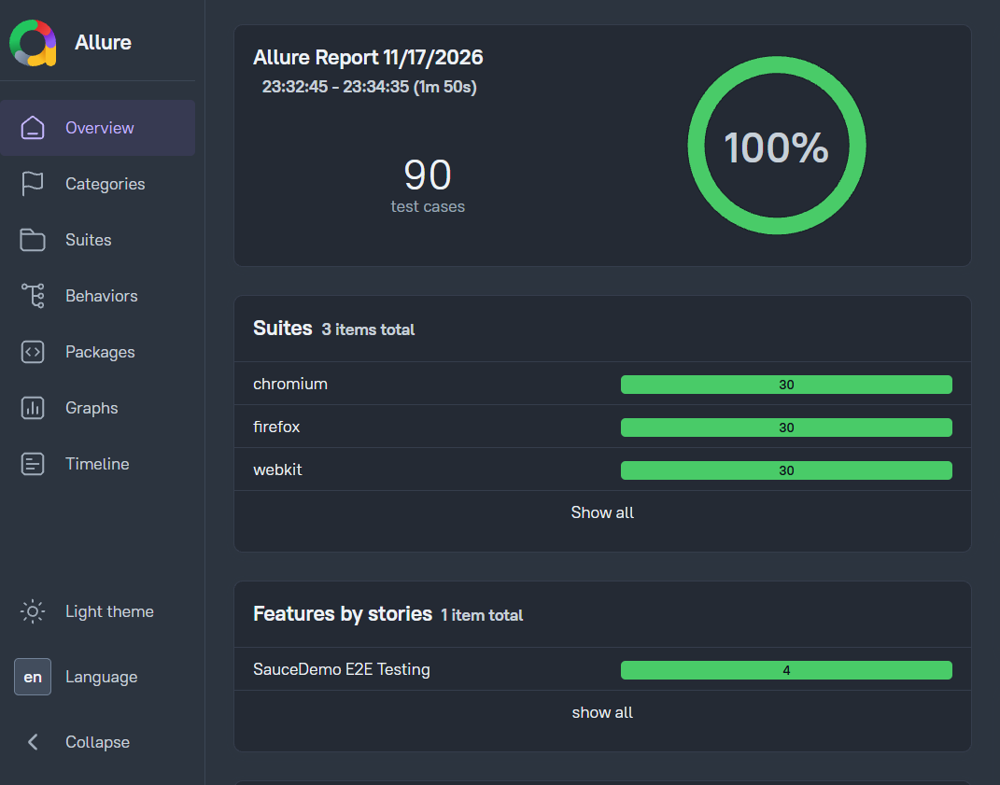

# SauceDemo - Playwright E2E Automation

An End-to-End test automation project for [SauceDemo](https://www.saucedemo.com/) using **Playwright** and **TypeScript**.

This project demonstrates practical UI automation skills, Page Object Model (POM), reusable fixtures, cross-browser testing, test data management, and automated test reporting with Allure.

## Tech Stack

- **Language:** TypeScript
- **Automation Framework:** Playwright
- **Test Runner:** Playwright Test
- **Design Pattern:** Page Object Model (POM)
- **Test Reporting:** Allure Report, Playwright HTML Report
- **Browsers:** Chromium, Firefox, WebKit
- **Version Control:** Git & GitHub
- **CI/CD:** GitHub Actions
- **Runtime:** Node.js
- **Package Manager:** npm

## Test Coverage

The project currently contains **30 test scenarios** across four modules.

| Module | Test Scenarios |
|---|---:|
| Login | 6 |
| Inventory | 12 |
| Cart | 4 |
| Checkout | 8 |
| **Total** | **30** |

The test suite is configured to run across three browsers: Chromium, Firefox, and WebKit.

A complete cross-browser execution runs **90 test executions** (30 scenarios × 3 browsers).

### Covered Scenarios

**Login**
- Successful login
- Invalid credentials
- Empty username and password
- Locked-out user validation

**Inventory**
- Inventory page validation
- Product count verification
- Product sorting by name and price
- Add and remove products from cart
- Multiple product selection

**Cart**
- Verify added products
- Remove products
- Continue shopping
- Proceed to checkout

**Checkout**
- Checkout information page validation
- Required field validation
- Successful order completion
- Cancel checkout
- Order total calculation
- Product price verification

## Project Structure

```text
saucedemo-qa/
│
├── .github/
│   └── workflows/
│       └── playwright.yml
│
├── fixtures/
│   └── test-fixtures.ts
│
├── pages/
│   ├── LoginPage.ts
│   ├── InventoryPage.ts
│   ├── CartPage.ts
│   └── CheckoutPage.ts
│
├── test-data/
│   └── users.ts
│
├── tests/
│   ├── login.spec.ts
│   ├── inventory.spec.ts
│   ├── cart.spec.ts
│   └── checkout.spec.ts
│
├── screenshots/
│   ├── github-repository.png
│   ├── github-actions-success.png
│   ├── allure-overview.png
│   └── allure-features.png
│
├── .gitignore
├── .gitattributes
├── package.json
├── package-lock.json
├── playwright.config.ts
└── README.md
```

## Installation

### Prerequisites

- Node.js
- npm
- Git

### Clone the repository

```bash
git clone https://github.com/MaryamKordi-Qa/saucedemo-playwright-e2e.git
```

### Navigate to the project directory

```bash
cd saucedemo-qa
```

### Install dependencies

```bash
npm ci
```

### Install Playwright browsers

```bash
npx playwright install
```

## Running Tests

### Run all tests

```bash
npm test
```

### Run tests in a specific browser

**Chromium**
```bash
npm run test:chromium
```

**Firefox**
```bash
npm run test:firefox
```

**WebKit**
```bash
npm run test:webkit
```

### Run a specific test file

```bash
npx playwright test tests/login.spec.ts
```

### Run tests in headed mode

```bash
npx playwright test --headed
```

## Test Reports

### Playwright HTML Report

After test execution, open the HTML report using:

```bash
npm run report
```

### Allure Report

Generate the Allure report:

```bash
npm run allure:generate
```

Open the report:

```bash
npm run allure:open
```

Allure reports include test categorization using:

- Epic
- Feature
- Story
- Severity

## CI/CD

GitHub Actions is configured to automatically execute the Playwright test suite on every push and pull request targeting the `main` and `master` branches.

The workflow performs the following steps:

- Checks out the repository.
- Sets up Node.js and Java.
- Installs project dependencies.
- Installs Playwright browsers.
- Executes the automated test suite.
- Generates Allure test reports.
- Uploads Playwright HTML and Allure reports as workflow artifacts.

This setup enables automated cross-browser test execution and provides accessible test reports for reviewing execution results.

## Key Automation Concepts

- Page Object Model (POM)
- Reusable custom fixtures
- Cross-browser testing
- Test data management
- UI assertions and validations
- Test categorization and reporting
- Automated CI execution

## Project Screenshots

### GitHub Repository


### GitHub Actions - Successful Execution


### Allure Report - Overview



### Allure Report - Features


## Project Goal

The goal of this project is to demonstrate practical skills in QA Automation using Playwright and TypeScript, with a focus on maintainable test architecture, reusable components, reliable test execution, cross-browser testing, and clear test reporting.